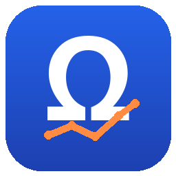
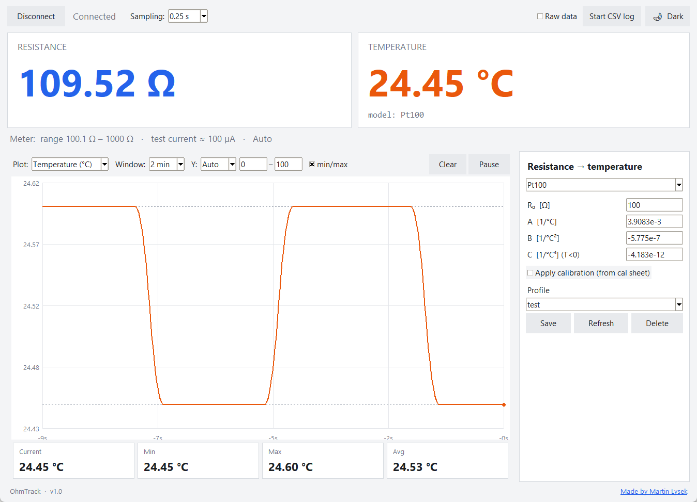

# OhmTrack



**OhmTrack** is a free, open-source desktop app for the **UNI-T UT620C+** micro-ohm
meter. It reads resistance live over USB, converts it to temperature (Pt100/Pt1000,
NTC, and more — with optional calibration), plots it, and logs to CSV. It's a modern,
cross-platform alternative to the bundled PC software.



## Quick start

1. **Put the meter in USB mode** — press and hold the **USB** button on the meter
   until the USB indicator appears on its display.
2. Connect the meter to the PC with the USB cable (close any other program that
   might be using it).
3. Launch OhmTrack and click **Connect**.
4. Choose your sensor in the right-hand panel (e.g. **Pt100**), optionally tick
   **Apply calibration** and enter your calibration points.
5. Read live resistance and temperature. Click **Start CSV log** to record to a file.

### Controls at a glance
- **Top bar** — Connect/Disconnect, sampling rate, Raw-data toggle, Start/Stop CSV
  log, light/dark theme.
- **Cards** — live resistance and temperature; the line below shows the meter's
  range, measuring current and auto/manual mode.
- **Graph** — pick what to plot, the time window and Y-axis; Pause/Clear; the tiles
  below show current / min / max / average.
- **Right panel** — sensor model and coefficients, calibration, and named profiles
  (Save / Refresh the list / Delete).

## Features

- **Live resistance** readout with the correct unit (µΩ / mΩ / Ω / kΩ).
- **Temperature conversion** with several sensor models:
  - **Pt100 / Pt1000** (Callendar–Van Dusen, editable coefficients),
  - **NTC** (Beta model, editable R₀ / β — e.g. 5 kΩ, 10 kΩ),
  - generic **linear** metal and the **copper-winding** resistance method.
- **Calibration** from your sensor's calibration sheet: tick the box, enter the
  (temperature → resistance) points and OhmTrack fits the curve for you
  (Callendar–Van Dusen for RTDs, Steinhart–Hart for NTCs).
- **Named sensor profiles** — save/load your setups (stored next to the app, portable).
- **Live graph** with selectable source (temperature/resistance), time window,
  auto/fixed Y-axis, min/max guides, and current/min/max/avg statistics.
- **Adjustable sampling rate** (0.1–10 s) and the meter's current range, mode and
  measuring current shown live.
- **CSV logging** with selectable columns — built for long unattended runs
  (bounded memory, data flushed continuously, keeps the PC awake, auto-reconnect).
- **Light / dark theme.**

## Supported meter

UNI-T **UT620C+** (USB) — see the [official product page][meter]. The app talks to
the meter over its standard USB HID interface — no extra drivers or proprietary
files needed.

[meter]: https://meters.uni-trend.com/product/ut620cplus-micro-ohmmeter/


## Download & run

### Windows (easiest)
Grab **`OhmTrack.exe`** from the [Releases](../../releases) page and double-click it.
Nothing to install — it's a single self-contained file.

### From source (any OS)
```bash
# Windows: no dependencies needed
python ut620_app.py

# Linux / macOS: install the open-source HID library first
pip install hidapi
python ut620_app.py
```
On Linux, allow access to the device by creating
`/etc/udev/rules.d/99-ut620.rules`:
```
SUBSYSTEM=="hidraw", ATTRS{idVendor}=="1a86", ATTRS{idProduct}=="e429", MODE="0666"
```
then `sudo udevadm control --reload && sudo udevadm trigger` (or replug).

> Close any other program that is using the meter before connecting — only one
> program can hold the USB port at a time.

## Using calibration

1. Pick your sensor model (e.g. **Pt100**).
2. Tick **Apply calibration (from cal sheet)**.
3. Enter the points from your calibration certificate as **temperature → resistance**
   (2 points minimum, 3 for a full fit). OhmTrack computes the coefficients and uses
   them for the live temperature.

## Temperature models

| Model | Equation |
|---|---|
| Pt100 / Pt1000 | Callendar–Van Dusen: `R = R₀(1 + A·T + B·T²)` |
| NTC (Beta) | `1/T = 1/T₀ + ln(R/R₀)/β` |
| Linear | `R = R₀(1 + α·(T − T₀))` |
| Copper winding | `T₂ = (R₂/R₁)·(k + T₁) − k`  (k = 235 Cu / 225 Al) |
| Calibration (RTD) | Callendar–Van Dusen fitted to your points |
| Calibration (NTC) | Steinhart–Hart fitted to your points |

## Build the standalone executable (Windows)

```bash
pip install pyinstaller
build_exe.bat        # -> dist\OhmTrack.exe  (~11 MB, self-contained, with icon)
```

## Project layout

| File | Purpose |
|------|---------|
| `ut620_app.py`    | the GUI application |
| `ut620_driver.py` | device class + reply decoding |
| `hid_win.py`      | native Windows HID backend (no dependencies) |
| `rtd.py`          | resistance → temperature conversions |
| `ut620_live.py`   | small console live monitor |

## Disclaimer

OhmTrack is an independent project and is **not affiliated with, endorsed by, or
supported by UNI-Trend (UNI-T)**. "UT620C+" and "UNI-T" are trademarks of their
respective owners and are used here only to describe compatibility. The software is
provided "as is", without warranty of any kind — use it at your own risk.

## License

[MIT](LICENSE) © Martin Lysek
